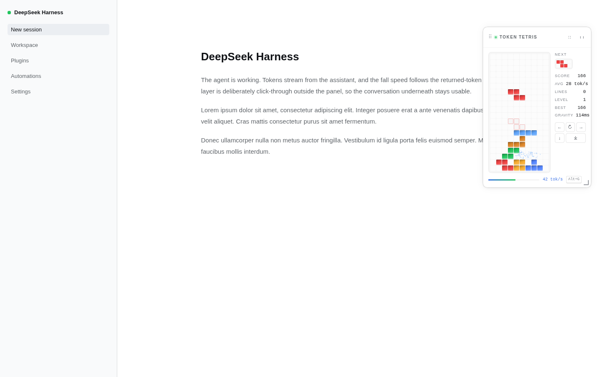
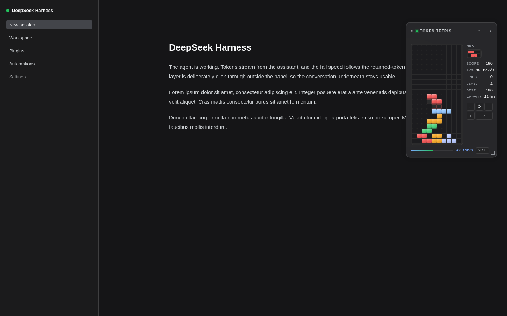
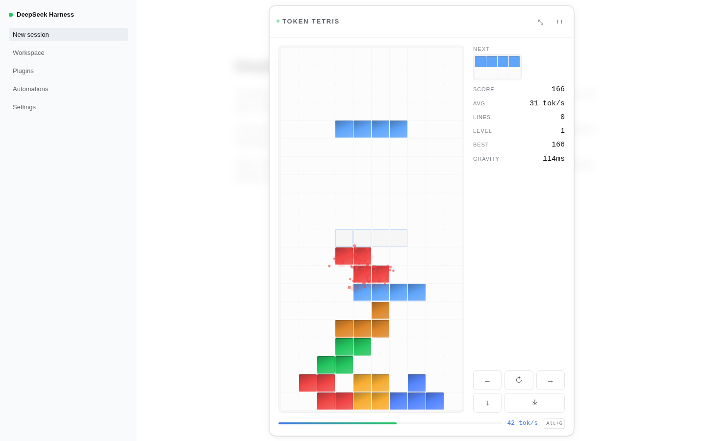
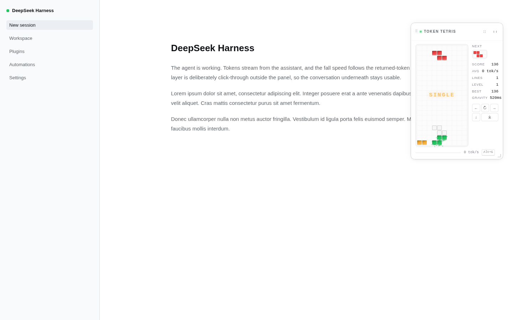

# Token Tetris

一个给 **DeepSeek Harness Web GUI** 使用的本地插件：当 Agent 正在工作时，在对话界面前方浮出一个俄罗斯方块小游戏。方块的重力来自助手实时返回的 token 速率——token 流得越快，方块落得越快。

| Light | Dark |
| --- | --- |
|  |  |





> 截图来自 `harness/` 的独立预览页；它复用 DSH 自身的 `--dsw-*` 主题变量，因此与真实界面的配色、字体、圆角和阴影一致。

## 行为

- **只在 Agent 工作时出现**：读取 root 作用域的 `useSessionStatus`，只要至少一个 Session 的 `running === true`，并且当前主面板仍是对话（`usePanelInfo` 的 `activePanelId === null`），才渲染游戏。
- **token 驱动重力**：监听当前运行中 Session 的 `assistant/live-chunk` 事件，统计 `text-delta`、`reasoning-delta` 和 `tool-call-delta` 的增量，用 2 秒滚动窗口估算 tok/s。映射关系为：
  - `0 tok/s` → 520 ms/格（比旧版更快的最低速度）
  - `42 tok/s` → 约 114 ms/格
  - `≥ 53 tok/s` → 95 ms/格（下限）
- **落点锁延迟**：方块触底后有 260ms 的锁延迟，期间仍可左右移动/旋转；左右键带 165ms DAS + 45ms 自动重复，因此高速下落时也能调整位置。
- **锁定沙化**：方块锁定时，锁定格会迸出彩色沙粒；沙粒受重力下落、旋转并淡出，看起来像方块碎成沙子。
- **平均 token 速度**：侧栏 `AVG` 显示本局按实际游玩时间加权的平均 tok/s；Game Over 弹窗同时显示最终得分与平均速率。
- **消行沙瀑**：整行消除时，行内所有方块化为大量彩色沙粒，同时出现横向闪光和 `SINGLE` / `DOUBLE` / `TRIPLE` / `TETRIS` 提示。
- **自动聚焦 / 失焦暂停**：面板出现时自动获取焦点，并在约 2.5s 内多次重试，避免首次加载或发送消息后聊天输入框抢回焦点；面板失去焦点、窗口 blur 或标签页隐藏时自动暂停；未聚焦时面板顶部会显示明显的操作提示。重新点击面板或按 `P` 继续。
- **主题**：面板、文字、边框、阴影、按钮全部使用 `--dsw-*` 语义 token；深色模式通过 `body[data-ds-dark-theme]` 自动切换。
- **不阻塞对话**：注册在 `shell.overlay`（frame 级浮动层）。浮层本身是 click-through 的，只有游戏面板接收指针事件。
- **速率显示**：底部进度条右侧显示当前 tok/s 与 `Alt+G` 聚焦提示。
- **可拖动 / 可缩放**：拖动标题栏移动窗口，拖动右下角手柄缩放棋盘；`cell` 大小与位置会保存到浏览器 `localStorage`（`dsh.token-tetris.layout.v1`），下次运行继续使用。
- **全屏**：点击标题栏的全屏按钮或按 `F`，以半透明、带背景模糊的浮层覆盖整个聊天列，在聊天窗口前方放大游戏；侧栏仍保持可见。点击面板外或按 `Escape` 退出。
- **操作**：点击游戏面板获得焦点后，`←/→` 移动、`↑` 旋转、`↓` 软降、`Space` 硬降、`P` 暂停、`R` 重开、`F` 全屏、`Escape` 退出全屏/暂停；按 `Alt+G` 可从任意位置聚焦游戏；也提供屏幕按钮。若焦点在输入框/编辑器里，游戏不会抢键盘。
- **最高分**：存在浏览器 `localStorage`，key 为 `dsh.token-tetris.high-score.v1`。

## 安装

插件同时是一个 DSH **bundle**（`dsh.bundle`）和一个浏览器插件（`dsh.client`），因此既可以用 `dsh plugin` 安装，也可以把仓库作为本地 link 安装。

发布到 npm 后：

```bash
dsh plugin --profile web add dsh-plugin-token-tetris
# 或者：npm pack 后安装本地 tarball
dsh plugin --profile web add ./dsh-plugin-token-tetris-0.1.5.tgz
# 或者：从源码目录 link
dsh plugin --profile web add /home/stone/Web/dsh-tetris-plugin
```

安装后 DSH 会读取包里的 [cordis.patch.yml](cordis.patch.yml)，插入 `token-tetris` 这一行；行里的 `name: dsh-plugin-token-tetris` 由 Node 从 profile 的 `node_modules` 解析，浏览器半则通过 `dsh.client` 的 `./client` export 提供。

> 当前环境是通过 profile 的用户 patch 以绝对路径安装的。若要切换到 npm/link bundle，请先从 [cordis.patch.yml](/home/stone/.dsh/profiles/web/cordis.patch.yml) 删除手写的 `token-tetris` 条目，否则用户层会覆盖 bundle 行。

Web profile 已启用 `patchReload: live`，安装/保存后会自动重新组合；若页面没有自动更新，刷新一次页面。

### 手动安装（开发/离线）

构建 Host 与浏览器两半：

```bash
cd /home/stone/Web/dsh-tetris-plugin
node scripts/build.mjs        # 需要 Bun
```

然后在 `~/.dsh/profiles/web/cordis.patch.yml` 加入：

```yaml
- insert:
    - id: token-tetris
      name: '/home/stone/Web/dsh-tetris-plugin/lib/index.js'
```

路径必须是绝对路径。插件通过 `dsh.client` 声明浏览器半包，Host 会从同一 package 的 `./client` export 读取 `lib/client.js`。

## 发布到 npm

包名 `dsh-plugin-token-tetris` 在编写时未被占用；发布前先确认：

```bash
npm view dsh-plugin-token-tetris version
# npm ERR! 404 ... — 表示可用
```

准备并发布：

```bash
npm login                 # 已有 npm 登录可跳过
npm run build
npm test
npm pack --dry-run        # 检查 tarball 内容
npm publish --access public
```

`package.json` 已配置：

- `engines.dsh: ">=0.2.0 <0.3.0"` — 安装/启动时检查 DSH 版本
- `dsh.bundle.patch: "./cordis.patch.yml"` — bundle 的配置层
- `dsh.client.platform: "web"` — 浏览器半
- `prepack` / `prepublishOnly` — 发布前重新构建并跑测试
- `files` — 只发布 `lib/`、patch、README、LICENSE 和截图

如果 npm 包名已被占用，需要改 `package.json` 的 `name`，并同步 [cordis.patch.yml](cordis.patch.yml) 里的 `name`（client bundle 的 id 由构建脚本从包名生成）。发布后即可在 Plugins 页面或 CLI 中安装。

> npm 发布是公开且不可撤销的；建议先 `npm publish --dry-run`。启用 2FA 的账号需要 `--otp`。

## Discover / 插件市场

插件市场索引已经放在仓库里：

- 文件：[market/index.json](https://github.com/stonega/dsh-plugin-token-tetris/blob/main/market/index.json)
- 直接索引地址：`https://raw.githubusercontent.com/stonega/dsh-plugin-token-tetris/main/market/index.json`

在 DSH 的 **Plugins → Discover** 中添加这个 index URL，即可搜索并安装 `dsh-plugin-token-tetris`。索引使用格式 1，已通过 `@deepseek-ai/dsh-plugin-market-index` 的官方校验器验证。

当前这是**自托管索引**，还没有被官方市场索引收录；要出现在官方 Discover 列表里，仍需要官方 index 维护方收录。发布新版本时，在 [market/index.json](https://github.com/stonega/dsh-plugin-token-tetris/blob/main/market/index.json) 的 `versions` 中加入对应的 `version`、`publishTimestamp` 和 `source`，然后提交即可。

## 结构

```
src/index.ts                  Host 半：空的 Cordis 插件，只提供可被扫描的 Loader 条目
src/client/index.tsx         浏览器半：注册 shell.overlay、样式、locale、速率源
src/client/TokenTetrisOverlay.tsx  浮层/游戏组件
src/client/game.ts            纯俄罗斯方块规则（棋盘、7-bag、消行、计分、重力、锁延迟）
src/client/layout.ts          窗口位置/尺寸的 localStorage 持久化
src/client/token-rate.ts      Session 事件 → 滚动 token/s 估算
src/client/styles.ts          主题化 CSS（--dsw-*）
src/client/locale.ts          en / zh 字典
cordis.patch.yml              DSH bundle 层（插入 token-tetris 行）
market/index.json             Discover 市场索引（格式 1，自托管）
scripts/build.mjs             Bun 打包 + __ModuleLoader__ 包装
tests/                        纯逻辑与速率源测试
harness/                      独立 UI 预览页（开发用）
lib/                          构建产物
```

## 开发

```bash
npm test                       # 或分别 bun tests/game.test.ts / bun tests/token-rate.test.ts
node scripts/build.mjs
```

独立预览：

```bash
# 从 DSH 安装目录链接 React（仅本地开发需要）
mkdir -p node_modules
ln -s /path/to/react node_modules/react
ln -s /path/to/react-dom node_modules/react-dom
ln -s /path/to/scheduler node_modules/scheduler

NODE_ENV=production bun build harness/main.tsx --outfile harness/dist.js --target=browser
python3 -m http.server 40710 --bind 127.0.0.1
# 打开 http://127.0.0.1:40710/harness/
```

`harness/theme/*.css` 是从 `@deepseek-ai/dsh-client-ui-theme` 的构建产物中提取的主题 token，仅用于让预览页与真实 DSH 外观一致；真实插件不依赖这些文件。

## 实现说明

- **Slot**：`shell.overlay` 是 frame-wide 的 `list` 槽位，默认 click-through；每个条目自行决定是否接收指针事件。插件用 `ctx.slots.inject('shell.overlay', ...)` 等待声明，再把组件注册进去。
- **状态来源**：`useSessionStatus` 和 `usePanelInfo` 是框架提供的 root 标准 props；token 速率是插件通过注册的 `inject: () => ({ hooks: { tokenRate } })` 暴露的 bare observable，由 renderer 绑定成 `useTokenRate(selector)`。
- **速率源**：`ctx.sessions.list` 提供 running Session 列表，`ctx.sessions.binding(id).eventSource` 提供已物化 Session 的实时事件窗口。插件只读 append 的 transient chunk，不 retain、不打开历史、不发 Host RPC。
- **窗口管理**：拖动/缩放只改变本地几何状态；全屏会测量当前聊天列（`centerCol`）的边界，在 `shell.overlay` 内绘制半透明 backdrop + 居中面板，不改变 DSH 布局本身。
- **模型侧**：没有任何 model-facing 变更，不写 session 记录；KV cache 不受影响。

## 参考

- [Your first plugin](https://deepseek-harness.github.io/deepseek-harness/en/develop/basic/)
- [Web Client architecture](https://github.com/deepseek-ai/deepseek-harness/blob/master/docs/subsystems/web-client.md)
- [Web Client Slots](https://github.com/deepseek-ai/deepseek-harness/blob/master/docs/subsystems/slots.md)
